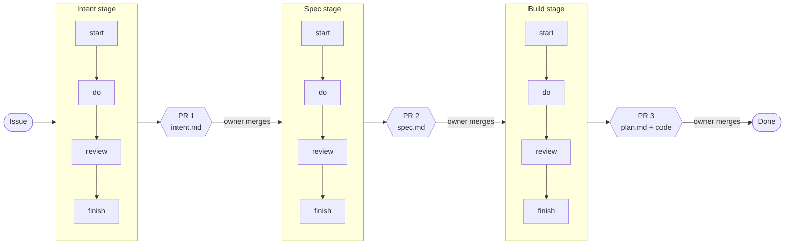

# softwaregravy-sdlc

A software development lifecycle packaged as Claude Code skills. A project opts in, names its stack, and gets its process from here: an idea becomes a GitHub issue, then an intent, a spec, and a reviewed pull request, with a human merge at each stage.

It follows Anthropic's [AI-native SDLC playbook](https://claude.com/resources/articles/the-ai-native-sdlc-playbook).

**Status: early.** The core plugin is a walking skeleton: the hooks below exist and are all empty. [`PLAN.md`](PLAN.md) holds the design, the decisions and the phases.

## How work flows



Every pull request targets the default branch. A stage starts only when the previous stage's file is on that branch.

## Stages

| Stage | Starts from | Produces | Ends with |
|---|---|---|---|
| Intent | A GitHub issue | `intent.md`: one clear, single-item statement of what is wanted and why | PR 1 |
| Spec | A merged intent | `spec.md`: requirements and design, plus a decision record for each decision made | PR 2 |
| Build | A merged spec | `plan.md`, then code, tests and updated docs | PR 3 |

The three files for one piece of work sit together in `intent/<issue#>-<slug>/`.

## Steps

Every stage runs the same four steps, in order.

| Step | What it does | In Intent | In Build |
|---|---|---|---|
| start | Reads the inputs and writes a plan for the stage | Read the issue, find related issues, propose a split or merge | Write `plan.md` and check it against the spec |
| do | Produces the stage's file or code | Interview the owner, write `intent.md` | Implement the plan test-first |
| review | Every listed reviewer checks the result in a fresh context | Is it clear, and is it a single item? | Does it meet the standards, and does it match the spec? |
| finish | Opens the pull request | PR 1 | PR 3 |

## Hooks

A hook is one step of one stage, named `<stage>.<step>`. There are twelve. A skill runs because a manifest lists it under a hook; a hook with nothing listed does nothing.

The skills below are the core's planned defaults. None exists yet.

| Hook | Planned core skills |
|---|---|
| `intent.start` | `intent-start` |
| `intent.do` | `intent-interview`, `intent-write` |
| `intent.review` | `review-intent` |
| `intent.finish` | `pr-open` |
| `spec.start` | `spec-start` |
| `spec.do` | `spec-grill`, `spec-write` |
| `spec.review` | `review-spec-doc` |
| `spec.finish` | `pr-open` |
| `build.start` | `plan-write`, `review-plan` |
| `build.do` | `implement`, `tdd`, `verify`, `docs-update` |
| `build.review` | `review-standards`, `review-against-spec` |
| `build.finish` | `pr-open` |

Three kinds of manifest attach skills to hooks, applied in this order:

1. **The core's** `plugins/sdlc/pipeline.toml` sets the defaults.
2. **A stack layer's** `pipeline.toml` adds to them. A Rails layer might add a migration reviewer to `build.review`.
3. **A project's** `.sdlc/pipeline.toml` has the last word: it can add a skill of its own, replace one, remove one, or empty a hook.

```toml
# <project>/.sdlc/pipeline.toml
[build.review]
add    = ["security-review"]            # any skill, by the name you would type to run it
remove = ["sdlc:review-standards"]
```

Every skill listed under a review hook gets a turn. `/sdlc:pipeline` prints the hooks for the current repo and says which manifest each skill came from.

## How it is organised

- **`plugins/sdlc`** is the core plugin: the pipeline, the pull request rules and repo setup.
- **Stack layers** are further plugins beside it, one per language, framework or hosting platform. Each is created the first time a rule needs it.
- **Always-on rules** reach a session through each plugin's session-start hook, which prints the plugin's `context.md`.

## Opting a project in

A project opts in with two tracked files. Each machine then sets the plugins up once.

### In the project

`.claude/settings.json` names the marketplace and switches on every plugin the project uses, including the ones a layer depends on:

```json
{
  "enabledPlugins": {
    "sdlc@softwaregravy-sdlc": true
  },
  "extraKnownMarketplaces": {
    "softwaregravy-sdlc": {
      "source": {
        "source": "github",
        "repo": "softwaregravy/softwaregravy-sdlc"
      },
      "autoUpdate": true
    }
  }
}
```

`CLAUDE.md` says that the project expects the plugin, so that a session on a machine without it says so instead of working without the process:

```markdown
This project's development process comes from the `sdlc` plugin of softwaregravy-sdlc. A session here opens with the line `SDLC plugin active: sdlc`. If that line is missing, the plugin isn't set up on this machine: say so before anything else, and point to the setup steps at https://github.com/softwaregravy/softwaregravy-sdlc#setting-up-a-machine.
```

### Setting up a machine

Once per machine, from any folder:

```bash
claude plugin marketplace add softwaregravy/softwaregravy-sdlc
claude plugin install sdlc@softwaregravy-sdlc --scope user
claude plugin disable sdlc@softwaregravy-sdlc --scope user
```

The plugin is then installed for your account but switched off, so it loads only in a project whose settings switch it on. A project's settings can switch a plugin on but can never install it: Claude Code leaves installing to you, because a plugin runs code. Each stack layer, once one exists, is set up the same way.

### Updates

No `version` is set, so every commit to this repo's default branch is a new version, named by its commit hash. Because the project's settings set `autoUpdate`, an interactive session in an opted-in project fetches the new version in the background, and the next session loads it. Headless sessions never update. On a machine that runs only those, run `claude plugin update sdlc@softwaregravy-sdlc --scope user`.

### Two commands to avoid inside a project

Run inside an opted-in project, `claude plugin uninstall --scope project` and `claude plugin marketplace remove` both empty `enabledPlugins` in the tracked settings file, which switches the plugins off for everyone. Run them from a folder outside any project, or check `git diff` afterwards.

Pointing a machine's projects at a local clone, so that an edit to the skills takes effect without a merge, is not settled yet.

## License

MIT. See [`LICENSE`](LICENSE).
